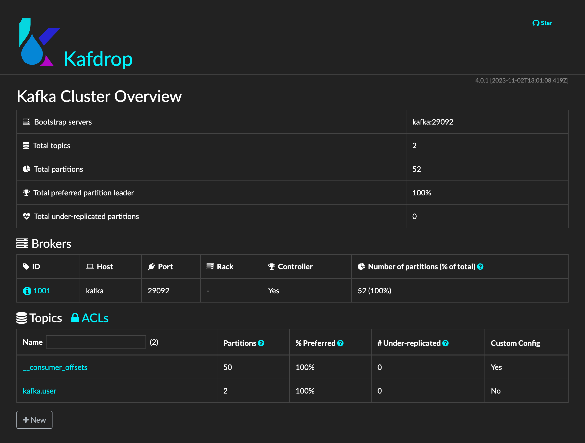

# spring-boot-kafka-test-sample

[](https://github.com/hendisantika/spring-boot-kafka-test-sample/actions/workflows/maven.yml)


Sample Spring Boot application that produces and consumes `User` messages with Apache Kafka, persists them to MySQL
(migrated with Flyway), and shows how to test Kafka & database code with **Embedded Kafka** and **Testcontainers**.

## Tech Stack

| Component        | Version / Tool                                                       |
|------------------|----------------------------------------------------------------------|
| Java             | 25 (Temurin)                                                         |
| Spring Boot      | 4.1.x (Web, Data JPA, Validation, Kafka, Flyway, Docker Compose)     |
| Messaging        | Apache Kafka (Spring for Apache Kafka, Jackson 3 JSON serializers)   |
| Database         | MySQL 8.4 + Flyway migrations                                        |
| API Docs         | springdoc-openapi (Swagger UI)                                       |
| Testing          | JUnit 5, Mockito, `@EmbeddedKafka`, Testcontainers 2.x, H2           |
| Build / CI       | Maven Wrapper, GitHub Actions, Dependabot                            |

## Prerequisites

- JDK 25
- Docker (used by Spring Boot Docker Compose support at runtime and by Testcontainers in tests)

## Getting Started

1. Clone this repository:
   ```shell
   git clone https://github.com/hendisantika/spring-boot-kafka-test-sample.git
   ```
2. Navigate to the folder:
   ```shell
   cd spring-boot-kafka-test-sample
   ```
3. Run the application (Zookeeper, Kafka, Kafdrop and MySQL from `compose.yaml` are started automatically):
   ```shell
   ./mvnw clean spring-boot:run
   ```
4. Open Kafdrop: http://localhost:8085
5. Open Swagger UI: http://localhost:8080/swagger-ui

## API Endpoints

| Method | Path                     | Description                                                  |
|--------|--------------------------|--------------------------------------------------------------|
| GET    | `/v1/users/random`       | Generate a random user and publish it to Kafka               |
| GET    | `/v1/users/{firstName}`  | Get users by first name (case-insensitive)                   |
| GET    | `/v1/users`              | List all users                                               |

## Running Tests

```shell
./mvnw clean verify
```

Docker must be running: `UserServiceTest` and `SpringBootKafkaTestSampleApplicationTests` start MySQL and Kafka
containers via Testcontainers, while the producer/consumer tests use `@EmbeddedKafka`.

## CI & Dependency Updates

- **GitHub Actions** (`.github/workflows/maven.yml`) builds and tests the project on JDK 25 for every push and pull
  request to `main`, and submits the Maven dependency graph on pushes to `main`.
- **Dependabot** (`.github/dependabot.yml`) keeps Maven dependencies (daily), GitHub Actions and Docker Compose images
  (weekly) up to date, with grouped pull requests and conventional commit prefixes.

## Screenshots

Swagger UI


Kafdrop UI


